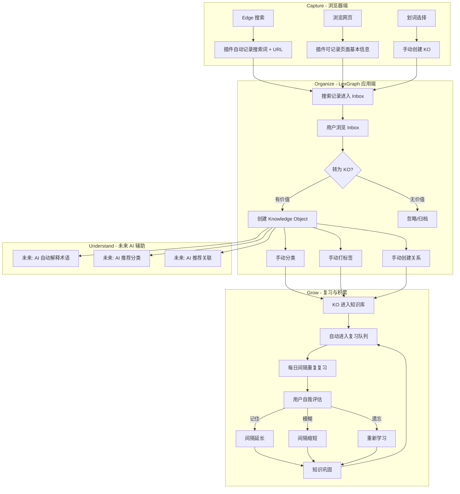
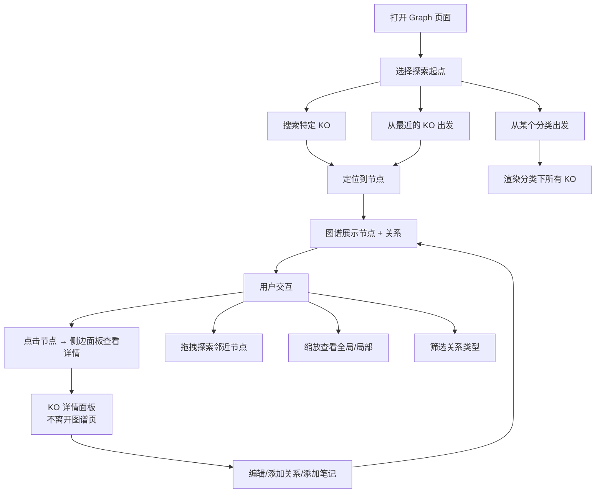
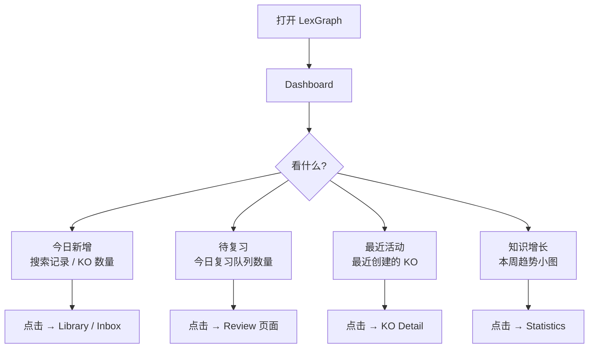
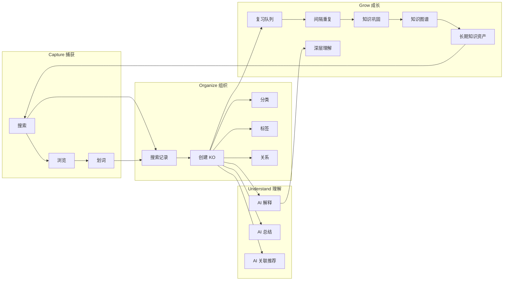
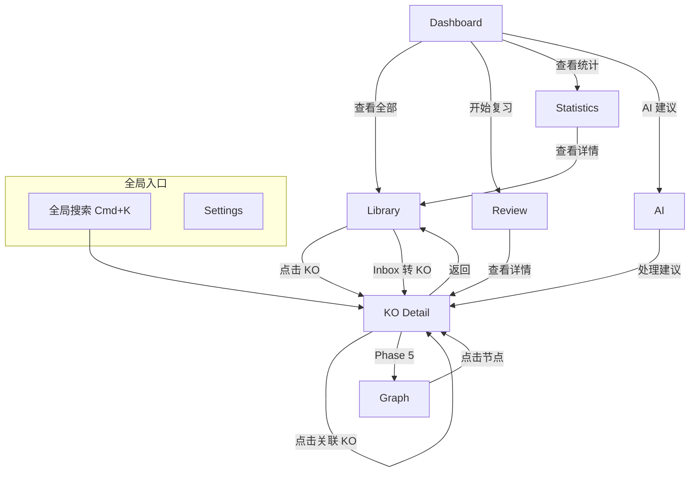
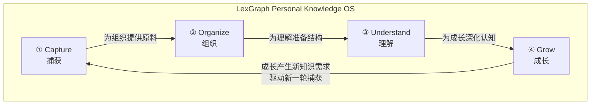
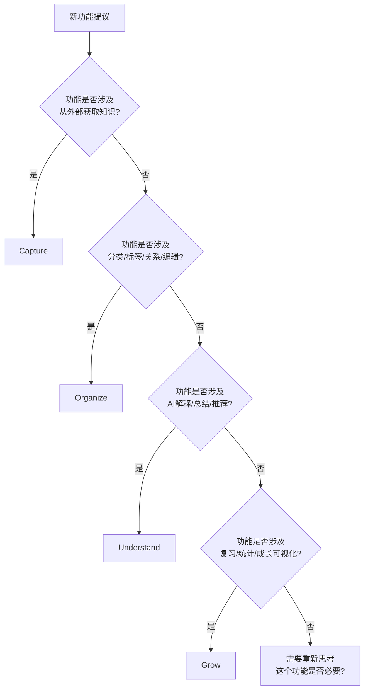
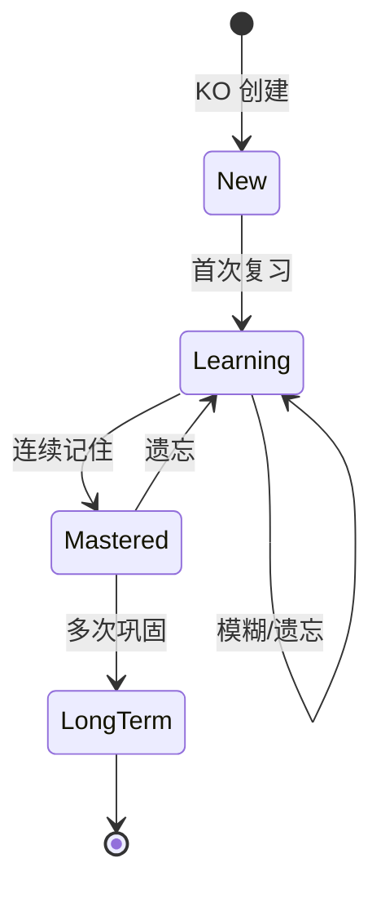
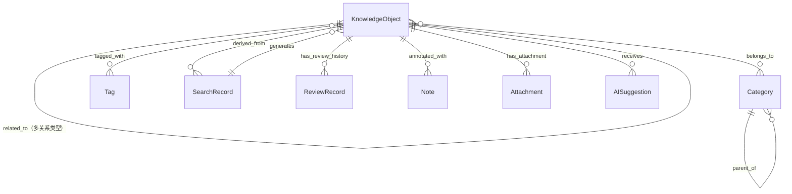
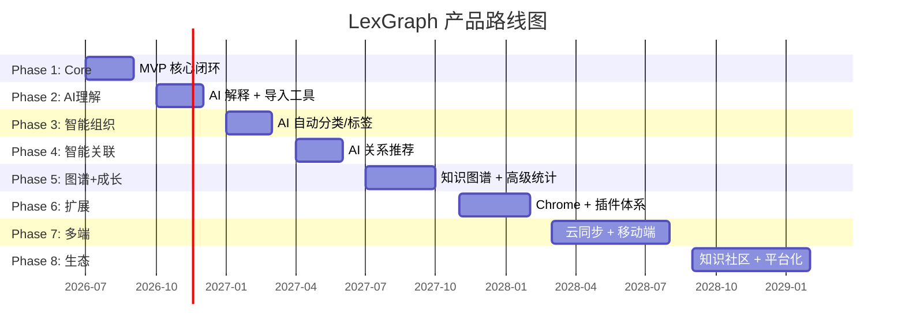

# LexGraph 产品架构设计文档（Sprint 1）

> **Build Your Personal Knowledge Universe**
>
> 版本：v0.2.0 — Sprint 1
> 状态：架构设计阶段（禁止编码）
> 作者：Product Team
> 日期：2026-07-01

---

## 目录

1. [产品定位](#第一章-产品定位)
2. [产品设计理念](#第二章-产品设计理念)
3. [用户画像](#第三章-用户画像)
4. [用户完整使用流程](#第四章-用户完整使用流程user-journey)
5. [产品信息架构](#第五章-产品信息架构information-architecture)
6. [产品能力模型](#第六章-产品能力模型capability-model)
7. [核心模块设计](#第七章-核心模块设计)
8. [核心数据对象](#第八章-核心数据对象概念设计)
9. [MVP 设计](#第九章-mvp-设计moscow)
10. [产品路线图](#第十章-产品路线图roadmap)
11. [风险分析](#第十一章-风险分析)
12. [成功指标](#第十二章-成功指标success-metrics)

---

## 第一章 产品定位

### 1.1 LexGraph 是什么？

**LexGraph 是一个 Personal Knowledge Operating System（个人知识操作系统）。**

它不是：
- 一个背单词软件
- 一个笔记软件
- 一个收藏夹工具
- 一个 AI 聊天机器人

它是：
- 一个在浏览器中**自动捕获**知识的系统
- 一个将碎片化搜索**结构化组织**的工具
- 一个帮助用户**真正理解**所学内容的 AI 辅助层
- 一个驱动知识**长期积累和成长**的平台

### 1.2 为什么做这个产品？

**核心洞察：知识工作者每天在浏览器中消耗 4-8 小时获取知识，但这些知识几乎 100% 流失。**

一个典型的知识工作者每天：
- 搜索 20-50 次
- 阅读 30-100 个页面
- 遇到 10-30 个不熟悉的概念、术语、人名、方法
- 收藏 3-5 个页面（然后永远不再打开）

现有的工具链条存在一个巨大的断层：

```
搜索 → 阅读 → 理解 → ??? → 长期记忆 → 可调用的知识资产
```

"???" 这个环节，目前没有任何工具真正填上。

- 用户要么手动记笔记（太重，不可持续）
- 要么依赖收藏夹（太浅，不可检索）
- 要么什么都不做（知识流失，下次重新搜索）

**LexGraph 填的就是这个断层。**

它让每一次浏览器搜索、每一次页面浏览，都自动沉淀为属于用户自己的结构化知识资产。

### 1.3 它解决的核心问题

| 问题 | 现状 | LexGraph 的方案 |
|------|------|----------------|
| **知识流失** | 搜索过的内容 3 天后遗忘约 70% | 搜索记录自动捕获 → 转化为 Knowledge Object → 持久化积累 |
| **知识孤岛** | 每个概念孤立存在，没有关联 | 多维度关系系统 → 为知识图谱准备数据结构 |
| **搜索即遗忘** | 搜索过的词下次仍然不会 | 间隔重复复习机制，搜索变成学习 |
| **收藏即埋葬** | 收藏的内容永远不再打开 | 收藏自动转化为结构化 Knowledge Object，而非一个死链接 |
| **笔记摩擦过大** | 手动整理太累，不整理又乱 | 插件零摩擦捕获，用户只需要确认和微调 |
| **知识不可检索** | "我明明看过但找不到了" | 全文搜索 + 多维度筛选 + 未来语义搜索 |

### 1.4 竞品深度分析

#### 1.4.1 与 Obsidian 的区别

| 维度 | Obsidian | LexGraph |
|------|----------|----------|
| **知识来源** | 用户手动输入 Markdown 文件 | 浏览器搜索/浏览自动捕获 + 手动补充 |
| **核心对象** | Markdown 文件（文档） | Knowledge Object（结构化知识单元） |
| **组织方式** | 文件夹 + 双向链接 `[[]]` | 多分类 + 多标签 + 多维关系 |
| **输入摩擦** | 高（需主动打开、主动书写） | 低（插件后台自动记录） |
| **图谱能力** | 本地文件链接图谱（单关系类型） | 语义关系图谱（多关系类型 + 权重） |
| **复习机制** | 无内置（依赖社区插件） | 原生内置间隔重复系统 |
| **AI 能力** | 依赖社区插件 | Native 集成（能力层，非聊天机器人） |
| **定位** | 手动知识管理工具 | 个人知识操作系统 |

**关键差异：Obsidian 假设用户会主动打开软件写笔记。LexGraph 假设用户很忙——知识应该在浏览器中自动被捕获，用户只需在方便时 Review。两者不是替代关系，而是解决不同场景。Obsidian 适合「深度写作和思考」，LexGraph 适合「广度知识的自动积累」。**

#### 1.4.2 与 Notion 的区别

| 维度 | Notion | LexGraph |
|------|--------|----------|
| **定位** | 全能工作空间（文档 + 数据库 + 项目管理） | 专注浏览器知识操作系统 |
| **知识捕获** | 手动输入 + Web Clipper（仅存页面） | 自动提取结构化 Knowledge Object |
| **数据模型** | 用户自定义数据库（灵活但需搭建） | 预设 Knowledge Object 最佳实践模型 |
| **图谱** | 无 | Graph-Driven Data Model（未来可视化） |
| **学习曲线** | 高（需要自己设计系统） | 低（自动化 + AI 辅助，开箱即用） |
| **AI** | Notion AI（文档内辅助写作） | AI 是能力层（解释、分类、关联、复习推荐） |

**关键差异：Notion 是「万能白板」——你可以搭建任何系统，但需要你知道怎么搭。LexGraph 是「专用操作系统」——预设了知识管理的最佳实践，用户不需要成为系统设计师。**

#### 1.4.3 与 Zotero 的区别

| 维度 | Zotero | LexGraph |
|------|--------|----------|
| **知识类型** | 学术文献（论文、书籍、报告） | 所有类型 Knowledge Object（概念/术语/人物/方法/算法/论文/组织/…） |
| **捕获方式** | 浏览器插件抓取文献元数据（DOI/ISBN） | 搜索词捕获 + 页面内容分析 + 划词创建 |
| **使用场景** | 论文写作 + 文献引用管理 | 日常知识积累 + 学习 + 研究 |
| **关系系统** | 文献引用关系（单向） | 多维语义关系（10+ 种关系类型，有向） |
| **目标用户** | 学术研究者（写论文的人） | 科研人员 + 学生 + 程序员 + 知识工作者 |
| **复习** | 无 | 内置间隔重复 |

**关键差异：Zotero 是「学术论文管理专家」，LexGraph 是「通用知识操作系统」。Zotero 处理论文引用堪称完美，但无法处理"今天搜了一个 AI 术语""看到一个有趣的算法""遇到一个不认识的学者"——而这些才是知识工作者日常遇到最多的情况。**

#### 1.4.4 与 Anki 的区别

| 维度 | Anki | LexGraph |
|------|------|----------|
| **卡片来源** | 用户手动制作 / 下载共享牌组 | 自动从搜索/浏览记录生成 |
| **内容形式** | 正面-背面（Q&A 卡片） | 结构化 Knowledge Object（多维信息） |
| **知识关联** | 牌组（单层分类） | 多分类 + 多标签 + 多维关系 |
| **学习场景** | 主动背诵（考试备考） | 被动积累 + 主动复习 |
| **内容上下文** | 孤立的 Q&A | 保留原始搜索语境 + 来源链接 |
| **知识广度** | 仅限"可以做成卡片"的知识 | 所有类型知识 |

**关键差异：Anki 解决「记住」，LexGraph 解决「知道你知道什么 → 理解 → 记住 → 建立联系」。Anki 是优秀的记忆强化工具，但它的核心假设是"你已经知道要记什么"——LexGraph 进一步解决了"你要记的东西从哪来"这个问题。**

#### 1.4.5 与浏览器收藏夹的区别

| 维度 | 浏览器收藏夹 | LexGraph |
|------|-------------|----------|
| **保存内容** | URL + 标题 | 结构化 Knowledge Object（从页面提取） |
| **组织结构** | 文件夹树（单亲） | 多分类 + 多标签 + 多维关系 |
| **检索方式** | 按文件夹翻找 / URL 搜索 | 全文搜索 + 分类/标签筛选 + 未来图谱导航 |
| **知识提取** | 零（只是一个链接） | AI 提取核心概念、术语、关系 |
| **长期价值** | 几乎为零（收藏即遗忘） | 随时间指数增长 |
| **去重** | 可能同一个东西收藏多次 | 自动去重检测 |

**关键差异：收藏夹存的是「书签」，LexGraph 存的是「知识」。一个 URL 的价值在于它承载的知识，而不是它本身。LexGraph 将网页内容转化为可理解、可检索、可关联的 Knowledge Object。**

#### 1.4.6 与沉浸式翻译的区别

| 维度 | 沉浸式翻译 | LexGraph |
|------|-----------|----------|
| **核心功能** | 网页即时双语翻译 | 知识捕获 → 组织 → 理解 → 成长 |
| **知识留存** | 无（翻译即消失） | 持久化知识积累 |
| **学习闭环** | 仅解决「当下的阅读理解」 | 完整闭环：输入 → 结构化 → 关联 → 复习 → 内化 |
| **AI 定位** | 翻译工具 | 知识理解辅助（解释术语 → 分类 → 关联 → 复习推荐） |

**关键差异：沉浸式翻译解决「当下理解」（让你读懂这一页），LexGraph 解决「长期积累」（让你记住你读过什么）。两者互补而非竞争——翻译帮你读懂，LexGraph 帮你记住并关联你读懂的东西。**

#### 1.4.7 与欧路词典的区别

| 维度 | 欧路词典 | LexGraph |
|------|---------|----------|
| **知识范围** | 仅限单词和固定搭配 | 所有类型 Knowledge Object（概念/术语/人物/方法/论文/…） |
| **输入方式** | 划词查询 | 搜索自动捕获 + 划词补充 |
| **学习方式** | 单词卡片复习 | 多维知识复习（不仅是"翻译"，而是"理解"） |
| **图谱** | 无 | Graph-Driven 数据模型 |
| **知识深度** | 词典释义 | AI 解释 + 关联概念 + 上下文 |

**关键差异：欧路词典围绕「单词」，LexGraph 围绕「Knowledge Object」。单词只是 Knowledge Object 的众多子类型之一。LexGraph 可以管理单词，但不停留在单词层面——它把「Transformer」当作一个算法概念来管理，而不是一个英文单词来翻译。**

#### 1.4.8 与 ChatGPT / AI Chat 的区别

| 维度 | ChatGPT | LexGraph |
|------|---------|----------|
| **知识归属** | 对话记录属于平台，散落在历史记录中 | 知识完全属于用户，结构化持久存储 |
| **知识持久性** | 随对话淹没（"我三个月前问过什么？"） | 本地持久化，永久积累 |
| **知识关联** | 无（每次对话基本独立） | 知识图谱关联（跨会话、跨时间） |
| **个人化程度** | 通用回答，对"你"毫无了解 | 基于个人知识库的深度个性化 |
| **离线可用** | 否 | 是（Local First，离线完整可用） |
| **AI 定位** | AI 是对话主体 | AI 是知识能力层（辅助理解，不替代思考） |

**关键差异：ChatGPT 给你答案，LexGraph 帮你积累和拥有知识。ChatGPT 的 AI 是「对话机器人」，LexGraph 的 AI 是「知识辅助能力」——它解释术语、推荐分类、发现关联，但不去替代你的思考和记忆。**

### 1.5 LexGraph 的独特价值主张（USP）

```
LexGraph ≠ 单词管理工具
LexGraph ≠ 笔记软件
LexGraph ≠ 收藏夹
LexGraph ≠ AI 聊天机器人

LexGraph = 个人知识操作系统
        = 自动捕获 + 结构化组织 + AI 辅助理解 + 长期成长
        = 让每一次搜索都成为你永久知识资产的一部分
```

**一句话：在浏览器中自动积累和成长你的个人知识宇宙。**

没有任何一个现有产品做到了这四件事的整合。竞品各自覆盖了其中 1-2 个能力，但没有人将它们整合成一个完整的**知识操作系统**。

### 1.6 产品竞争定位图

```
                    AI 原生
                       ↑
                  ChatGPT
                       │
                       │  LexGraph ★
                       │  (自动捕获 + 知识图谱 + AI能力层)
                       │
    手动 ← ─ ─ ─ ─ ─ ─┼─ ─ ─ ─ ─ ─ ─ → 自动
         Obsidian      │
         Notion        │      浏览器收藏夹
         Zotero        │      沉浸式翻译
         Anki          │
         (手动制卡)     │
                       ↓
                    传统工具
```

LexGraph 的独特位置：**右上角。AI Native + 自动化捕获 + 结构化知识管理。**

# 当前版本明确不做

为了保证产品简单、稳定、长期可维护，以下内容不属于近期开发目标：

- ❌ 不做多人协作
- ❌ 不做团队知识库
- ❌ 不做复杂权限系统
- ❌ 不做在线文档编辑
- ❌ 不做即时聊天
- ❌ 不做大型数据库优化
- ❌ 不做移动端 App
- ❌ 不做插件市场
- ❌ 不做复杂 AI Agent
- ❌ 不做企业级功能

LexGraph 首先是一个高质量的个人知识工具，而不是企业产品。

---

## 第二章 产品设计理念

产品设计理念是 LexGraph 所有决策的最高准则。每一项功能、每一次交互、每一个技术选型都对齐这些理念。

### 2.1 四大核心能力（Capability-Driven）

**原则：整个产品的底层逻辑由四大能力定义——Capture、Organize、Understand、Grow。**

每一个功能、每一个模块、每一个未来需求，都必须明确归属于这四大能力之一。

原因：
- 防止产品功能膨胀失控（任何新功能必须有"能力归属"）
- 确保产品始终围绕核心价值，而非追逐热点
- 为用户提供可理解的心智模型：LexGraph 帮我「捕获→组织→理解→成长」
- 为技术架构提供清晰的服务边界

四大能力详见 [第六章：产品能力模型](#第六章-产品能力模型capability-model)。

### 2.2 Knowledge Object First（知识对象优先）

**原则：整个产品围绕 Knowledge Object 设计，而非围绕文档、单词、页面、笔记设计。**

原因：
- 知识的最小单元不是"文档"，而是一个可独立理解的知识对象（一个概念、一个人物、一个方法……）
- 文件/文档是知识的容器，Knowledge Object 是知识本身
- 以 Knowledge Object 为中心，才能建立跨领域、跨来源、跨时间的知识关联
- 未来的 AI 能力天然适合以 Knowledge Object 为单位进行处理
- 为知识图谱准备数据基础——图谱的节点是 Knowledge Object，不是页面 URL

**实践影响：**
- 一个网页可能产生多个 Knowledge Object（而非一个网页 = 一个条目）
- 同一个 Knowledge Object 可以有多个来源（搜索、划词、手动、AI 对话、导入）
- 不用「背单词」的思维设计功能——用「管理知识对象」的思维

### 2.3 Graph-Driven Data Model（图谱驱动的数据模型）

**原则：从第一天起，数据模型就为知识图谱设计。即使 MVP 不做图谱页面。**

原因：
- 知识的本质是网络，不是列表，不是文件夹树
- 如果数据模型一开始没有设计关系能力，后期加图谱 = 数据迁移灾难
- 文件夹树有根本局限：一个概念只能放在一个文件夹里（或者靠标签弥补）
- 图谱不仅是一种可视化，更是一种思考和组织知识的范式

**实践影响：**
- 每个 Knowledge Object 从创建起就支持多维度关系
- 关系是数据模型的一等公民，不是后来拼接的元数据
- 所有分类/标签/搜索都预留图谱维度的查询能力
- Phase 5 做图谱可视化时，数据模型不需要任何修改

### 2.4 Automation First（自动化优先）

**原则：能自动完成的，绝不要求用户手动操作。**

原因：
- 知识管理的最大敌人是摩擦。任何需要额外操作的功能，用户忙起来就跳过
- 用户的核心行为是「浏览和搜索」，知识捕获应该在这个过程中无感发生
- 只有把捕获成本降到接近零，长期知识积累才可能持续

**实践影响：**
- 浏览器搜索引擎的每一次搜索自动记录（Capture）
- 后续 AI 可自动推荐分类、标签、关联（Understand → Organize）
- 复习计划自动生成，无需手动排期（Grow）
- 用户的角色从「录入者」变成「确认者和组织者」

### 2.5 Local First + Offline First（本地优先 + 离线优先）

**原则：用户数据首先、始终、完全存储在用户自己的设备上。云端只做同步，不做主数据源。**

原因：
- 知识是高度私有的数字资产，用户必须拥有完全的所有权
- 离线可用是刚需（飞机上、通勤中、网络故障时）
- 响应速度：本地数据访问延迟 << 网络请求延迟
- 参考 Obsidian 的成功——本地优先 = 用户信任 = 长期留存
- Offline First 意味着：断网时产品不仅"能打开"，而是"功能完整"

**实践影响：**
- 本地 IndexedDB 是唯一的主数据源（Single Source of Truth）
- 所有 CRUD 操作默认在本地完成，不依赖网络
- 未来云同步（Phase 7）是可选增强，不是核心功能
- AI 处理优先使用本地能力，云端模型仅在必要时调用且数据最小化上传

### 2.6 AI as Capability Layer（AI 作为能力层）

**原则：AI 不是产品的主角和卖点。AI 是整个产品底层的辅助能力。**

原因：
- AI 产品容易陷入"为 AI 而 AI"的陷阱——硬塞聊天界面，但用户不知道怎么用
- LexGraph 的核心是「知识操作系统」，AI 是使这个系统更智能的一层能力
- AI 的演进路径清晰：解释 → 分类 → 关联 → 复习优化
- 用户感知到的不是"一个 AI 聊天机器人"，而是"这个产品越来越懂我的知识体系"

**实践影响：**
- 没有独立的 AI Chat 页面作为产品主入口
- AI 能力嵌入在各个业务模块中（解释按钮、分类建议、关联推荐、复习计划）
- AI 的输出是「建议」，用户的确认是最终决定
- AI 服务层可切换 Provider（本地模型 / 云端模型）

### 2.7 Long-Term First（长期积累优先）

**原则：每个设计决策都要问：用户用了三年 LexGraph 之后，这个设计还能 work 吗？**

原因：
- LexGraph 的价值随时间指数增长，不同于"用完即走"的工具
- 如果产品不能承载 1 万、5 万、10 万个 Knowledge Object，用户的前期投入就是沉没成本
- 数据迁移成本极高——结构设计必须一次做对

**实践影响：**
- 数据模型支持万级以上的 Knowledge Object 和关系
- 搜索和筛选设计考虑大规模数据场景
- 不依赖"用户手动整理"来维持可用性（AI 辅助组织）
- 导出格式标准化，用户永远可以带走完整数据
- 不做破坏性数据迁移

### 2.8 Beauty Matters（品质优先）

**原则：工具的审美品质直接影响用户的使用意愿和对产品的信任。**

原因：
- 知识管理工具是需要每天打开的产品，丑陋的界面会潜意识降低使用频率
- 高质量的产品设计传递一个信号：「你的知识值得被认真对待」
- 参考 Linear、Raycast、Arc Browser、Things——最优秀的工具都极其注重品质

**实践影响：**
- 字体、间距、色彩、动效有明确规范
- 减少视觉噪音——每一个像素都有存在的理由
- 交互细节打磨到位（过渡动画、加载状态、空状态、错误状态）
- 不是 Demo 品质，是产品品质

### 2.9 设计理念优先级

理念之间发生冲突时，按以下优先级裁决：

```
Knowledge Object First > Graph-Driven > Automation First
> Local First > AI as Capability Layer
> Long-Term First > Beauty Matters
```

**示例裁决：**
- 如果某个 AI 功能要求强制上传数据 → 违反 Local First → 重新设计为本地执行
- 如果某个手动功能"暂时不做 AI 版"→ 接受。Automation First 是方向，不是 MVP 的硬性要求
- 如果一个 UI 动效会影响大规模数据下的性能 → Long-Term First 优先于 Beauty Matters

---

## 第三章 用户画像

### Persona 1：NLP 研究生 · 小林

| 维度 | 描述 |
|------|------|
| **背景** | 24 岁，计算机专业研二，研究方向 NLP，实验室常驻人口 |
| **日常** | 每天 50+ 次搜索，阅读 5-10 篇论文/博客，Edge 常开 40+ 标签页 |
| **目标** | 发顶会论文，顺利毕业，进大厂 AI Lab |
| **痛点** | ① 读过的论文两周后忘了核心方法和结论 ② Zotero 存了 300 篇论文但只读了摘要 ③ 经常搜到一篇论文才发现"三个月前搜过同一个关键词" ④ 笔记散落在 Notion、Typora、纸质本、微信收藏里 |
| **使用场景** | ① 搜索论文 → 自动记录 → 提取关键概念 ② 浏览技术博客 → 记录核心方法 → 关联到已知概念 ③ 组会前快速回顾自己积累的相关知识网络 |
| **为什么需要 LexGraph** | Zotero 管文献但不管概念，Notion 管笔记但不自动。小林需要的是：让每一次学术搜索和阅读自动沉淀为可检索、可关联的知识体系 |

### Persona 2：保研学生 · 小陈

| 维度 | 描述 |
|------|------|
| **背景** | 21 岁，大三，GPA 前 10%，目标保研 TOP 5 |
| **日常** | 搜索导师信息、研究方向、专业课资料、竞赛经验、面经 |
| **目标** | 系统化构建专业知识体系，面试时展现扎实的知识广度和深度 |
| **痛点** | ① 搜过的方向太多太杂，无法体系化 ② 面试前不知道从哪开始复习 ③ 收藏夹变成黑洞——存了 200 多个链接，打开的不超过 5 个 ④ 焦虑——"我到底学了什么？我和别人的差距在哪？" |
| **使用场景** | ① 搜索某教授 → 创建 Person KO → 关联研究方向和论文 ② 浏览专业概念 → 自动捕获 → 系统自动归类到相关课程领域 ③ 面试准备 → 按领域查看自己的知识积累全景 |
| **为什么需要 LexGraph** | 保研是「知识广度和深度的证明」。小陈需要可视化地看到自己积累了什么、掌握了什么、还有哪些空白 |

### Persona 3：转行 AI 的产品经理 · Alex

| 维度 | 描述 |
|------|------|
| **背景** | 28 岁，B 端产品经理，自学 AI 准备转 AI PM |
| **日常** | 碎片化学习——X（Twitter）、公众号、B站、博客、GitHub、播客 |
| **目标** | 系统化掌握 AI 知识，跟上行业速度，在新岗位有竞争力 |
| **痛点** | ① AI 新概念爆炸式出现（RLHF → RAG → Agent → MCP → …），学了就忘 ② 学习来源太分散，没有统一积累渠道 ③ 概念关系复杂但不清楚（"Transformer 和 Attention 到底什么关系？"）④ 稍后读 = 永远不读 |
| **使用场景** | ① X 上看到"RLHF"→ 划词捕获 → 创建 KO → 未来 AI 自动给出定义和关联概念 ② 浏览 GitHub 项目 → 记录项目信息 → 关联技术栈 ③ 每周回顾自己新学了什么概念 |
| **为什么需要 LexGraph** | 碎片化学习时代，来源越多越需要统一的"知识收件箱"。LexGraph 自动收集碎片，帮助 Alex 看到全景图 |

### Persona 4：全栈程序员 · 张工

| 维度 | 描述 |
|------|------|
| **背景** | 32 岁，全栈开发，10 年经验，技术栈广 |
| **日常** | 每天大量搜索技术问题、查阅文档、浏览 GitHub、读技术博客 |
| **目标** | 高效解决问题，沉淀技术经验，保持技术竞争力 |
| **痛点** | ① "这个问题我明明去年解决过，但现在完全不记得怎么搞的" ② 浏览器历史不可检索，收藏夹不可检索 ③ 技术更新太快——学了新的忘了旧的 ④ 面试/述职时无法系统展示自己的技术积累 |
| **使用场景** | ① Debug 搜索 StackOverflow → 解决方案自动记录为 KO ② 学习新技术 → 关键概念自动捕获 → 关联已有知识 ③ 技术方案选型 → 查看自己积累的相关技术对比 |
| **为什么需要 LexGraph** | 程序员的知识资产本质上是「搜索和解决问题的能力」。LexGraph 把每次搜索和解决变成可积累的资产 |

### Persona 5：副教授 · 王老师

| 维度 | 描述 |
|------|------|
| **背景** | 42 岁，计算机系副教授，带 5 个研究生 |
| **日常** | 大量文献阅读、基金申请、学术会议、审稿、指导研究生 |
| **目标** | 保持领域前沿，高效指导学生，持续产出高质量论文 |
| **痛点** | ① 学生做的方向自己不一定深入，难以全局把握 ② 跨学科合作时新领域门槛高 ③ 一年看 200+ 论文，无法有效追踪 ④ 基金申请需要展示对领域的系统性理解 |
| **使用场景** | ① 浏览新论文 → 自动归类到研究子领域 ② 学生汇报 → 快速回顾相关概念群 ③ 基金申请 → 知识全景图展示研究脉络 |
| **为什么需要 LexGraph** | 教授的核心资产是「领域的系统性理解」。LexGraph 帮助维护和可视化这种系统性 |

### Persona 6：终身学习者 · 小李

| 维度 | 描述 |
|------|------|
| **背景** | 35 岁，自由职业，热爱跨领域学习 |
| **日常** | 每天浏览 Wikipedia、长文、播客、纪录片 |
| **目标** | 广度知识积累，发现跨领域连接，满足好奇心 |
| **痛点** | ① 兴趣太广，学习的知识碎片化 ② 跨领域连接自己很难发现 ③ 过段时间就忘了之前感兴趣的话题 ④ "我明明知道有个东西相关，但想不起来了" |
| **使用场景** | ① Wikipedia 浏览 → 创建 KO 链（哲学→物理学→生物学）② 意外发现两个看似无关的领域的连接 ③ 回顾自己的知识探索历程 |
| **为什么需要 LexGraph** | 终身学习者的需求不是「深度掌握一个领域」，而是「广泛积累并发现意外连接」。图谱和知识关联是核心价值 |

---

## 第四章 用户完整使用流程（User Journey）

### 4.1 首次使用：从零到第一个 Knowledge Object

```mermaid
flowchart TD
    A[安装 Edge 插件] --> B[3 步 Onboarding]
    B --> C[选择关注的知识领域<br/>可选跳过]
    C --> D[授权插件访问搜索记录]
    D --> E[进入 Dashboard 空白状态]
    E --> F[空白状态引导：<br/>"开始搜索，LexGraph 会自动记录"]
    F --> G[用户在 Edge 中搜索<br/>"Transformer 注意力机制"]
    G --> H[插件自动记录搜索]
    H --> I[Dashboard 出现第一个<br/>搜索记录]
    I --> J[用户点击 → 转为 KO]
    J --> K[手动选择分类<br/>"AI → 深度学习 → NLP"]
    K --> L[手动添加标签<br/>"重要" "基础" "NLP"]
    L --> M[第一个 KO 创建完成]
    M --> N[知识积累循环开始]
```

### 4.2 日常核心闭环：搜索 → 捕获 → 组织 → 复习



### 4.3 知识探索流程（未来图谱导航 — Phase 5）



### 4.4 Dashboard 信息聚合（每日打开的第一眼）



### 4.5 完整的知识生命周期（四大能力覆盖）



---

## 第五章 产品信息架构（Information Architecture）

### 5.1 设计原则

在进入具体页面之前，先明确 Navigation 的设计原则：

1. **导航围绕用户任务（Task）设计，不围绕能力（Capability）设计**
2. **一个页面可以服务多个能力**
3. **Dashboard 是整个产品的 Information Hub，不是一级业务模块**
4. **页面之间通过数据流动形成网络，而非严格的层级树**

### 5.2 能力 × 导航矩阵

下表展示每个页面服务了哪些底层能力（● 核心服务 / ○ 辅助服务）：

| 页面 | Capture | Organize | Understand | Grow |
|------|:-------:|:--------:|:----------:|:----:|
| **Dashboard** | ● 展示今日捕获 | ● 展示组织变化 | ● 展示 AI 推荐 | ● 展示复习提醒 |
| **Library** | ● 展示捕获来源 | ● 核心管理页面 | ○ 展示 AI 分类建议 | ○ 展示复习状态 |
| **KO Detail** | ○ 显示来源 | ● 编辑/分类/标签/关系 | ● AI 解释入口 | ○ 复习记录 |
| **Graph** | — | ● 关系可视化 | ○ AI 关联高亮 | ● 知识网络全景 |
| **Review** | — | — | — | ● 复习核心页面 |
| **AI** | — | — | ● AI 能力门户 | ○ 学习推荐 |
| **Statistics** | ○ 捕获统计 | ○ 组织统计 | — | ● 成长可视化 |
| **Settings** | — | — | — | — |

> 这个矩阵是导航设计的底层逻辑。**一个页面对应多个能力是正常的，这正是「操作系统」的特质——不是工具拼盘，而是能力聚合。**

### 5.3 整体导航结构

```
LexGraph（Edge 插件 + Web App）
│
├── 🔹 Dashboard（首页 / Information Hub）
│   ├── 今日捕获概览
│   ├── 待复习提醒
│   ├── 最近知识活动
│   ├── AI 建议摘要
│   └── 知识增长小趋势
│
├── 🔹 Library（知识库）
│   ├── Inbox（待处理搜索记录）
│   ├── 全部 Knowledge Object
│   ├── 按分类浏览
│   ├── 按标签浏览
│   ├── 按来源浏览
│   ├── 按时间线浏览
│   └── 搜索 & 筛选
│
├── 🔹 Knowledge Object Detail（知识对象详情）
│   ├── 基本信息
│   ├── 分类 & 标签编辑
│   ├── 关系管理（列表视图）
│   ├── 来源记录（哪次搜索/哪个页面）
│   ├── 复习记录
│   ├── 笔记
│   ├── AI 解释 / 总结入口
│   └── 相关 Knowledge Object 推荐
│
├── 🔹 Graph（知识图谱 — Phase 5）
│   ├── 全局/局部图谱视图
│   ├── 力导向布局
│   ├── 节点交互（点击/拖拽/缩放）
│   ├── 搜索定位
│   ├── 关系筛选
│   └── 图谱导出
│
├── 🔹 Review（复习中心）
│   ├── 今日复习队列
│   ├── 主题复习（按分类）
│   ├── 自由浏览复习
│   ├── 复习统计
│   └── 复习设置
│
├── 🔹 AI（AI 能力门户）
│   ├── 待处理的 AI 建议
│   ├── 术语解释记录
│   ├── 分类推荐
│   ├── 关联推荐
│   └── AI 设置
│
├── 🔹 Statistics（数据中心）
│   ├── 知识增长趋势
│   ├── 领域覆盖度
│   ├── 复习效果分析
│   ├── 活跃度热力图
│   └── 知识盲区分析
│
├── 🔹 Settings（设置）
│   ├── 通用设置
│   ├── 知识领域配置
│   ├── AI 设置
│   ├── 数据管理（导出/导入/备份）
│   ├── 外观设置
│   └── 关于与反馈
│
└── 🔹 Onboarding（首次引导）
    ├── 产品价值传达
    ├── 知识领域选择
    ├── 插件安装引导
    └── 权限授权
```

### 5.4 各页面详细说明

#### 5.4.1 Dashboard — Information Hub

**定位：不是一级业务模块。是整个产品的 Home，所有模块数据的聚合展示层。**

**为什么存在？**
用户打开 LexGraph 的第一眼，需要在 3 秒内获得两个信息：
- 「我的知识体系在增长」（成就感）
- 「今天有什么需要我做的？」（行动指引）

**主要职责：**
- 聚合展示 Capture 层数据：今日新增搜索记录数、新增 KO 数
- 聚合展示 Organize 层数据：最近分类/标签变化
- 聚合展示 Understand 层数据：AI 最近生成的建议（待处理）
- 聚合展示 Grow 层数据：今日待复习数量、本周知识增长趋势

**不负责（重要）：**
- ❌ 不执行捕获操作 → 去插件
- ❌ 不执行分类/标签编辑 → 去 Library
- ❌ 不执行复习 → 去 Review
- ❌ 不执行 AI 对话 → 去 AI

**数据来源：**
Dashboard 自身不产生数据。它是只读聚合视图。

**跳转关系：**
- 点击「今日新增」→ Library（Inbox）
- 点击「待复习」→ Review
- 点击「最近 KO」→ KO Detail
- 点击「统计卡片」→ Statistics
- 点击「AI 建议」→ AI 页面

#### 5.4.2 Library — 知识库管理中心

**定位：用户管理所有 Knowledge Object 的核心页面。是 Organize 能力的主要承载者。**

**为什么存在？**
用户需要一个地方按不同维度浏览、搜索、批量管理所有 KO。随着知识积累，Library 是最频繁使用的页面之一。

**主要职责：**
- Inbox（待处理搜索记录的暂存区）
- 多种浏览模式（列表 / 卡片 / 表格式）
- 按分类树、标签云、时间轴导航
- 多条件组合筛选
- 批量操作（分类、标签、删除）
- 搜索 + 筛选

**Inbox 设计：**
- 搜索记录进入 Inbox，而非直接创建 KO
- 用户审查后决定：转为 KO / 忽略 / 稍后处理
- Inbox 是 Capture → Organize 的缓冲层，保证用户对知识有掌控感

**跳转关系：**
- 点击 KO → KO Detail
- 点击分类名 → Library 按该分类筛选
- 点击标签 → Library 按该标签筛选

#### 5.4.3 Knowledge Object Detail — 知识对象详情

**定位：每个 Knowledge Object 的「个人主页」。是所有操作的集中入口。**

**为什么存在？**
用户需要深入了解、编辑、关联一个具体的知识对象。这是 "Everything is Knowledge Object" 在 UI 层的体现。

**主要职责：**
- 展示 KO 完整信息
- 编辑所有字段
- 分类和标签管理
- 关系管理（创建/查看/编辑关联 KO）
- 展示知识溯源（来自哪次搜索、哪个页面）
- 展示复习历史
- 个人笔记
- AI 解释 / 总结入口按钮

**关系管理说明（重要）：**
- 在 KO Detail 中，关系以**列表形式**展示和管理
- "关联的 KO"列表，每条显示关系类型和方向
- 点击关联 KO → 跳转到另一个 KO Detail
- Phase 5 之前不在此页嵌入图谱视图

**跳转关系：**
- 点击关联 KO → 新的 KO Detail
- 返回 → Library
- 点击「加入复习」→ 无跳转（操作反馈）

#### 5.4.4 Graph — 知识图谱（Phase 5）

**定位：知识关系的可视化探索工具。是 LexGraph 最具差异化的页面。**

**为什么存在？**
人对网络结构的理解远优于列表结构。图谱让用户「看到」自己的知识体系，发现隐藏的关联。

**Phase 1-4 状态：**
此页面在 Phase 5 之前不存在。但**数据模型从第一天就为图谱设计**，所有 KO 和关系数据已经就绪。Phase 5 上线图谱时，用户的历史数据立即可用。

**Phase 5 首批功能：**
- 力导向布局
- 节点交互：点击查看、拖拽移动、缩放
- 搜索定位到节点
- 筛选关系类型
- 导出为图片

**主要职责：**
- 可视化知识网络
- 导航式探索（从一个节点跳到另一个节点）
- 发现知识盲区（没有连接的区域）
- 全局/局部视图切换

**跳转关系：**
- 点击节点 → KO Detail（侧边面板）
- 搜索定位 → 图谱聚焦到该节点

#### 5.4.5 Review — 复习中心

**定位：Grow 能力的核心承载页面。驱动知识从「短期记忆」到「长期内化」。**

**为什么存在？**
没有复习的知识积累是不完整的。捕获到的知识如果不回顾，3 天后遗忘约 70%，30 天后几乎归零。Review 是知识闭环的最后一环。

**主要职责：**
- 基于间隔重复算法生成每日复习队列
- 多种复习模式（卡片式 / 未来可能有填空、关联问答）
- 用户自评（记住 / 模糊 / 遗忘）
- 复习统计
- 复习提醒（Edge 通知）

**跳转关系：**
- 复习中点击「查看详情」→ KO Detail
- 完成复习 → 下一个（同页内）

#### 5.4.6 AI — AI 能力门户

**定位：Understand 能力的集中展示和入口。不是聊天界面。**

**为什么存在？**
用户需要一个地方查看 AI 为他们做了什么，以及管理 AI 设置。这不是一个聊天窗口，而是 AI 建议的管理面板。

**主要职责：**
- Phase 2：术语解释记录（"AI 为你解释了这些概念"）
- Phase 3：分类推荐待处理
- Phase 4：关联推荐待处理
- Phase 5：复习建议
- AI 功能开关和设置

**不负责（重要）：**
- ❌ 不做 AI 聊天界面
- ❌ 不做「问 AI 任何问题」的通用对话

**跳转关系：**
- AI 推荐列表 → 对应 KO Detail

#### 5.4.7 Statistics — 数据中心

**定位：Grow 能力的可视化呈现。量化知识积累，提供成就感。**

**为什么存在？**
用户需要感知到自己的进步和成长。数据可视化是最好的方式。参考 GitHub 贡献图的成就感机制。

**主要职责：**
- 知识增长趋势（日/周/月/年）
- 领域覆盖度
- 复习效果曲线
- 活跃度热力图（类 GitHub）
- 知识图谱规模统计

**跳转关系：**
- 点击统计中的分类 → Library（筛选）
- 点击热力图某天 → Library（该天的 KO）

#### 5.4.8 Settings — 设置

**定位：产品配置中心。每个模块的可配置项集中管理。**

**主要职责：**
- 通用设置（语言、默认分类）
- 知识领域配置
- AI 设置（模型选择、功能开关）
- 数据管理（导出 / 导入 / 备份 / 清理）
- 外观设置
- 关于与反馈

#### 5.4.9 Onboarding — 首次引导

**定位：用户第一次接触产品的前 3 分钟。决定留存的关键时刻。**

**主要职责：**
- 一句话传达产品价值
- 知识领域选择（可选跳过）
- 插件安装引导
- 权限授权引导
- 演示数据预览（展示"3 个月后的 Dashboard 长什么样"）

### 5.5 导航层级设计

```
Level 0（全局）
├── Search（Cmd/Ctrl + K 全局搜索）
└── Settings（齿轮图标）

Level 1（主导航 — 左侧栏）
├── 📊 Dashboard
├── 📚 Library
├── 🔮 Graph（Phase 5 才出现）
├── 📝 Review
├── 🤖 AI
└── 📈 Statistics

Level 2（页面内导航 — Library 为例）
├── Inbox
├── All Knowledge Objects
├── By Category
├── By Tag
└── By Timeline

Level 3（详情层 — 点击进入）
└── Knowledge Object Detail
```

### 5.6 页面跳转关系总图



---

## 第六章 产品能力模型（Capability Model）

> **本章是 LexGraph 产品架构的核心章节。**
>
> 能力模型定义了产品底层的四个核心能力。它们是设计哲学，不是功能列表，不是导航结构。
>
> 每一个功能、每一个模块、每一个未来的需求，都必须明确归属于至少一个能力。

### 6.1 四大能力总览



四个能力形成**正向循环**：

> 捕获（原料）→ 组织（结构）→ 理解（深度）→ 成长（内化）→ 捕获更多（扩展）

这个循环每转一圈，用户的知识体系就扩大和深化一轮。这就是「知识操作系统」的核心引擎。

### 6.2 ① Capture — 捕获

#### 设计目标

**将用户在浏览器中产生的所有可能的知识接触点，以最低摩擦的方式捕获到 LexGraph 系统中。**

捕获层回答的问题是：「用户今天遇到了什么新知识？」

#### 设计原则

- **零摩擦优先**：捕获不应该打断用户的浏览行为
- **全面但可选**：记录一切可能的来源，但让用户决定什么留下来
- **来源不可丢失**：每个 Knowledge Object 都能追溯到它的来源

#### 当前功能（MVP）

| 功能 | 说明 | 捕获方式 |
|------|------|----------|
| 搜索引擎搜索记录 | 在 Edge 中每次搜索自动记录 | 自动（插件监听） |
| 划词创建 KO | 选中网页中的文本 → 右键 → 创建 Knowledge Object | 手动（用户主动） |
| 页面基本信息记录 | 当前页面的标题、URL、域名 | 自动（辅助上下文） |

#### 未来可扩展能力

| 能力 | 说明 | 预计阶段 |
|------|------|----------|
| 页面核心概念自动提取 | 自动分析当前页面，识别核心概念/术语 | Phase 3 |
| 浏览器历史批量导入 | 导入已有浏览器历史记录，快速冷启动知识库 | Phase 2 |
| 浏览器收藏夹导入 | 将收藏夹链接批量转为 KO | Phase 2 |
| 页面截图自动保存 | 浏览页面时自动保存页面截图作为附件 | Phase 4 |
| PDF 元数据捕获 | 打开 PDF 时自动捕获标题/作者/摘要 | Phase 5 |
| RSS 订阅源捕获 | 订阅 RSS → 新文章自动创建 KO | Phase 6 |
| 视频/播客笔记 | 在看视频时标记时间点，创建关联 KO | Phase 7 |
| 桌面应用捕获 | VS Code 中查阅的文档、终端中的 man 命令等 | Phase 8 |

#### 边界

- 捕获层**不负责判断内容质量**——那是后续 AI（Understand）和用户（Organize）的工作
- 捕获层**不负责结构化**——只记录原始信息和上下文
- 捕获层的数据是「候选 KO」——进入 Inbox，不是直接入库

### 6.3 ② Organize — 组织

#### 设计目标

**将捕获到的原始知识碎片，转化为有结构、有分类、有关联的结构化 Knowledge Object 网络。**

组织层回答的问题是：「这些知识之间是什么关系？它们在你的知识体系中处于什么位置？」

#### 设计原则

- **用户拥有最终控制权**：AI 推荐分类/标签/关系，用户确认或修改
- **多维组织**：不依赖单一的组织方式（分类 + 标签 + 关系 三维并行）
- **Graph-Driven**：关系的设计为未来的图谱可视化和图分析做准备

#### 当前功能（MVP）

| 功能 | 说明 |
|------|------|
| 分类系统 | 层级树状分类（预设 + 用户自定义），一个 KO 可属于多个分类 |
| 标签系统 | 扁平标签，一个 KO 可有多个标签，与分类互补 |
| 关系系统 | 手动创建 KO 之间的关系，支持 6 种关系类型 |
| Inbox 管理 | 搜索记录的审查：转为 KO / 忽略 |

#### 未来可扩展能力

| 能力 | 说明 | 预计阶段 |
|------|------|----------|
| AI 自动分类推荐 | AI 推荐 KO 应该属于哪个分类 | Phase 3 |
| AI 自动标签推荐 | AI 推荐 KO 应该打什么标签 | Phase 3 |
| AI 关系推荐 | AI 推荐两个 KO 之间可能存在的关系 | Phase 4 |
| 智能去重 | AI 检测两个 KO 是否指向同一概念，建议合并 | Phase 4 |
| 分类模板市场 | 社区共享的分类模板（"NLP 研究者分类模板"） | Phase 8 |
| 动态分类 | 基于规则的自动分类（"最近 7 天新增的 AI 概念"） | Phase 5 |

#### 边界

- Organize 是用户**主动操作的层**，AI 只能推荐不能自动执行
- 分类、标签、关系三者**独立运作**，互不依赖
- Inbox 是 Capture → Organize 的**缓冲区**，保证用户有时间审查

### 6.4 ③ Understand — 理解

#### 设计目标

**通过 AI 能力帮助用户更深入地理解 Knowledge Object 的内容和上下文。降低理解门槛，加速知识内化。**

理解层回答的问题是：「这个知识到底是什么意思？它和什么相关？我还应该知道什么？」

#### 设计原则

- **AI 是辅助，不是替代**：AI 帮助理解，但用户自己思考和记忆
- **渐进式交付**：理解能力从简单（解释术语）向复杂（关联推理）逐步演进
- **不是聊天**：AI 以「建议」和「解释」的形式出现，不以对话为主体
- **上下文感知**：AI 可以利用用户已有的知识库来辅助理解

#### 当前功能（MVP）

**MVP 阶段无 AI 能力。**

MVP 的目标是验证「自动捕获 → 手动组织 → 复习」这个核心闭环是否有价值。AI 是加速器，不是引擎本身。

#### 按阶段演进的 AI 能力

| 阶段 | 能力 | 说明 |
|------|------|------|
| **Phase 2** | AI 解释术语 | 用户点击 KO 上的「AI 解释」按钮 → AI 给出定义、使用场景、通俗类比 |
| **Phase 3** | AI 自动分类 | AI 分析 KO 内容，推荐最合适的分类 |
| **Phase 4** | AI 关联推荐 | AI 分析两个 KO 是否相关，推荐关系类型 |
| **Phase 5** | AI 复习建议 | AI 分析用户的复习数据，推荐重点复习的薄弱知识 |
| **Phase 6** | AI 知识盲区分析 | AI 分析用户的知识体系，指出明显的知识缺口和相邻领域 |
| **Phase 7** | AI 学习路径规划 | AI 基于用户目标和现有知识，推荐下一步学习路径 |
| **Phase 8** | AI 知识综合分析 | AI 能跨多个 KO 进行综合分析、对比 |

#### 未来可扩展能力

| 能力 | 说明 |
|------|------|
| AI 论文摘要 | 对保存的论文 KO 自动生成中文摘要 |
| AI 知识对比 | "比较 Transformer 和 CNN 的异同"——基于用户已有 KO |
| AI 通俗解释 | "给我一个 5 岁小孩也能懂的解释" |
| 自定义 Prompt | 用户可自定义 AI 的解释风格和深度 |

#### 边界

- Understand 的输出是**推荐和建议**，永远不是自动执行
- AI 解释/分类/关联的结果都附带**置信度**，低置信度 = 更明显提示用户审查
- AI 调用是**异步**的，不阻塞用户操作
- 不保存用户的完整网页内容到 AI 服务端——只发送最小必要文本

### 6.5 ④ Grow — 成长

#### 设计目标

**驱动知识从「已经记录」到「真正内化」的转化过程。让用户的个人知识体系持续增长、深化、可量化。**

成长层回答的问题是：「我真的掌握了吗？我的知识体系在变大吗？我比三个月前进步了多少？」

#### 设计原则

- **复习是内化的必经之路**：捕获不等于学会，组织不等于记住
- **量化成就感**：让用户看到自己的成长轨迹——数据是最诚实的反馈
- **长期主义**：Grow 的效果以月/年为单位衡量，不是天/周

#### 当前功能（MVP）

| 功能 | 说明 |
|------|------|
| 间隔重复复习 | SM-2 算法，每日复习队列，卡片式复习 |
| 复习自评 | 记住 / 模糊 / 遗忘（用户主观评估） |
| 基础统计 | KO 总数、分类分布、复习次数 |

#### 未来可扩展能力

| 能力 | 说明 | 预计阶段 |
|------|------|----------|
| 知识图谱可视化 | 看到自己的知识网络全景 | Phase 5 |
| 高级统计与趋势 | 领域覆盖度、知识增长曲线、复习效果 | Phase 3 |
| 成就系统 | 里程碑徽章（"积累 100 个 KO""连续复习 30 天"） | Phase 5 |
| 知识盲区检测 | AI 分析知识体系中的空缺 | Phase 6 |
| 自适应复习算法 | 根据用户遗忘曲线自动调整间隔参数 | Phase 5 |
| 多模式复习 | 填空、关联问答、概念匹配 | Phase 6 |
| 协作复习 | 学习小组互相出题 | Phase 8 |
| 知识输出辅助 | 基于知识库辅助写作/汇报/论文 | Phase 7 |

#### 边界

- Grow 不创建新知识，只深化已有知识
- 复习算法是工具，不是目的——用户可以选择不复习
- 统计数据只读，不修改业务数据

### 6.6 能力与功能的归属判断标准

**当需要决定一个新功能归属时，使用以下判断流程：**



**一个功能可以归属多个能力。例如：**
- 「AI 推荐分类」→ Understand（AI 推理）+ Organize（分类操作）
- 「基于知识图谱的复习」→ Grow（复习）+ Organize（图谱是关系的可视化）

---

## 第七章 核心模块设计

### 7.1 模块总览

```
┌──────────────────────────────────────────────────────────────┐
│                    LexGraph System                            │
├──────────────────────────────────────────────────────────────┤
│                                                              │
│  ┌──────────────┐  ┌────────────────┐  ┌─────────────────┐  │
│  │ Edge         │  │  Knowledge     │  │  Review         │  │
│  │ Extension    │  │  Object        │  │  Engine         │  │
│  │ (Capture)    │  │  Manager       │  │  (Grow)         │  │
│  │              │  │  (Organize)    │  │                 │  │
│  └──────┬───────┘  └───────┬────────┘  └────────┬────────┘  │
│         │                 │                     │           │
│  ┌──────┴─────────────────┴─────────────────────┴────────┐  │
│  │               Core Data Layer                         │  │
│  │         IndexedDB + Dexie.js（本地唯一数据源）         │  │
│  └──────┬──────────────────────────────────────┬─────────┘  │
│         │                                      │            │
│  ┌──────┴──────────┐  ┌──────────────┐  ┌─────┴──────────┐  │
│  │  AI Service     │  │  Search      │  │  Sync (未来)   │  │
│  │  (Understand)   │  │  Engine      │  │  Phase 7       │  │
│  │  Phase 2+       │  │              │  │                │  │
│  └─────────────────┘  └──────────────┘  └────────────────┘  │
│                                                              │
└──────────────────────────────────────────────────────────────┘
```

### 7.2 模块与四大能力的映射

| 模块 | 主要服务能力 | 说明 |
|------|:----------:|------|
| Edge Extension | **Capture** | 知识的入口，零摩擦捕获 |
| Knowledge Object Manager | **Organize** | 知识的组织管理中心 |
| Category System | **Organize** | 层级分类 |
| Tag System | **Organize** | 扁平标签 |
| Relation System | **Organize** | 知识关系管理（Graph-Driven 基础） |
| Search History | **Capture** | 搜索记录的存储和转换 |
| Review Engine | **Grow** | 间隔重复复习 |
| Graph Engine | **Grow + Organize** | 知识图谱渲染（Phase 5） |
| AI Service | **Understand** | AI 能力服务层（Phase 2+） |
| Search Engine | **Organize** | 全文搜索 |
| Statistics | **Grow** | 数据统计与可视化 |
| Sync Module (Phase 7) | — | 云同步 |

### 7.3 Edge Extension（浏览器插件）— Capture 的前线

**职责：**
- 监听 Edge 搜索引擎的每次查询（Google / Bing / Baidu）
- 捕获搜索词、URL、时间戳、搜索引擎类型
- 提供划词右键菜单 → 创建 KO
- 通过 Native Messaging 或本地 HTTP 与 LexGraph 应用通信
- 管理浏览器权限（搜索记录访问、当前标签页信息、右键菜单）

**边界：**
- ❌ 插件不存储业务数据（只做传输）
- ❌ 插件不执行 AI 推理
- ❌ 插件不做复杂的页面内容解析（Phase 1-2）
- ✅ 插件只负责「监听 + 传输」，数据交给应用处理

**技术约束：**
- Manifest V3（Edge 强制要求）
- Service Worker 可能被浏览器休眠 → 需要健壮的唤醒和重连机制
- 搜索引擎 DOM 结构可能变化 → 多策略降级提取

### 7.4 Knowledge Object Manager — Organize 的核心

**职责：**
- KO 的完整 CRUD 操作
- KO 类型注册和扩展
- Inbox → KO 的转换流程
- 去重检测（同一搜索词不应重复创建）
- 批量操作

**边界：**
- ❌ 不管理关系数据（由 Relation System 负责）
- ❌ 不关心数据来源（统一接口接收所有来源的创建请求）
- ✅ Graph-Driven：从创建起就支持挂接关系

### 7.5 Category System — Organize 的维度之一

**职责：**
- 层级分类树管理（父-子关系）
- 预设分类模板（NLP / 计算机视觉 / 系统设计 / …）
- 一个 KO → 多个分类

**边界：**
- 分类是辅助组织方式，不是唯一的组织方式
- 分类层级不建议超过 4 层（过深 = 用户找不到）

### 7.6 Tag System — Organize 的维度之二

**职责：**
- 扁平标签管理
- 标签自动补全、颜色标记
- 一个 KO → 多个标签

**与分类的区别：**
- 分类 = "这属于哪个领域？"（层级、领域归属）
- 标签 = "这有什么属性？"（扁平、状态标记）

### 7.7 Relation System — Organize 的维度之三（Graph-Driven 基础）

**职责：**
- 定义和管理关系类型
- KO 之间关系的创建、编辑、删除
- 关系方向性和权重管理

**MVP 支持的关系类型（6 种）：**

| 关系 | 含义 | 示例 |
|------|------|------|
| `related_to` | 两个概念相关 | "梯度下降" ↔ "反向传播" |
| `is_a` / `has_subtype` | 下位/上位关系 | "CNN" → is_a → "深度学习模型" |
| `prerequisite_of` | A 是 B 的前置知识 | "线性代数" → "深度学习" |
| `part_of` / `has_part` | 整体-部分关系 | "Encoder" → part_of → "Transformer" |
| `proposed_by` / `proposed` | 提出者关系 | "Transformer" → proposed_by → "Vaswani et al." |
| `cites` / `cited_by` | 引用关系 | "BERT 论文" → cites → "Transformer 论文" |

**为什么这 6 种？**
- 覆盖了最常见的知识关系类型
- 每种都有明确的语义，不模糊
- 足够支撑知识图谱的基础结构
- 后续可扩展更多关系类型

**边界：**
- 关系的创建是**手动**的（MVP），未来 AI 推荐（Phase 4）
- 不支持自动关系推导

### 7.8 Review Engine — Grow 的核心引擎

**职责：**
- 实现间隔重复算法（SM-2 改进版）
- 生成每日复习队列
- 管理 KO 的复习状态
- 复习提醒

**复习状态机：**



**边界：**
- ❌ 不修改 KO 内容
- ✅ 复习算法参数可配置

### 7.9 AI Service — Understand 的能力层（Phase 2+）

**职责（按阶段演进）：**

| 阶段 | AI 能力 |
|------|---------|
| Phase 2 | 术语解释（用户触发 → AI 返回解释 → 展示在 KO Detail） |
| Phase 3 | 自动分类推荐 |
| Phase 4 | 关联关系推荐 |
| Phase 5 | 复习计划优化建议 |
| Phase 6+ | 知识盲区分析、学习路径规划 |

**架构约束：**
- AI Service 是独立的服务层，不绑定任何 Provider
- 可切换：本地模型（Ollama）/ 云端模型（OpenAI / Anthropic）
- 所有 AI 调用异步执行
- 用户数据最小化上传（只发送必要的文本，不发全量知识库）

**边界：**
- ❌ 不是聊天机器人
- ❌ 不能自动修改用户数据
- ✅ 输出永远是「建议」+「置信度」
- ✅ 用户决定是否采纳

### 7.10 Search Engine — 检索能力

**职责：**
- 全文搜索（KO 标题 + 描述 + 笔记）
- 多条件筛选（分类 + 标签 + 时间 + 来源 + 复习状态）
- 全局搜索快捷键（Ctrl/Cmd + K）

**边界：**
- Phase 1 做全文搜索
- Phase 3+ 可扩展语义搜索（向量检索）

### 7.11 Statistics Module — Grow 的可视化

**职责：**
- 聚合统计数据
- 趋势图、热力图、分布图
- 周报/月报数据

**边界：**
- 只读模块
- 不修改业务数据

---

## 第八章 核心数据对象（概念设计）

> **注意：本章仅做概念设计。不涉及数据库表结构、字段类型、SQL 语句。**
>
> 目标是定义「系统中有哪些概念实体，它们代表什么，它们之间如何关联」。
> 这是 Graph-Driven Data Model 的概念基础。

### 8.1 对象关系总览



### 8.2 Knowledge Object（知识对象）— 核心实体

**是整个系统围绕的中心。**

| 维度 | 说明 |
|------|------|
| **代表什么** | 用户知识体系中的一个独立知识单元。可以是一个概念、一个术语、一个人物、一篇论文、一个方法、一个算法、一个组织、一个工具…… |
| **唯一性** | 每个 KO 代表一个唯一的知识点。同一概念不应有两个 KO |
| **身份标识** | 标题（概念名）+ 类型组合确定唯一性 |
| **核心内容** | 标题、类型、定义/描述、来源链接、个人笔记 |
| **生命周期** | 创建（来自搜索/划词/手动）→ AI 推荐（未来）→ 用户确认/编辑 → 进入复习队列 → 长期积累 |

**Knowledge Object 的类型（Type）：**

| 类型 | 示例 | 说明 |
|------|------|------|
| `concept` | "梯度下降"、"RESTful API"、"注意力机制" | 抽象概念 |
| `term` | "RLHF"、"微服务"、"CORS" | 专业术语/缩写 |
| `person` | "Yann LeCun"、"Andrej Karpathy" | 人物（学者、作者、开发者） |
| `paper` | "Attention Is All You Need" | 学术论文 |
| `book` | "深度学习"（花书） | 书籍 |
| `method` | "贝叶斯优化"、"迁移学习" | 方法/技术 |
| `algorithm` | "Transformer"、"Q-Learning" | 算法 |
| `organization` | "OpenAI"、"Google DeepMind" | 组织机构 |
| `tool` | "PyTorch"、"Docker"、"Kubernetes" | 工具/软件/框架 |
| `event` | "NeurIPS 2024"、"ImageNet 挑战赛" | 事件/会议 |
| `website` | "arXiv"、"Papers With Code" | 网站/平台 |
| `theory` | "信息论"、"控制论"、"博弈论" | 理论/学科 |
| `formula` | "E=mc²"、"Bayes 定理" | 公式 |
| `custom` | 用户自定义类型 | 可扩展 |

### 8.3 Category（分类）— 层级化组织

| 维度 | 说明 |
|------|------|
| **代表什么** | 知识领域的树状分层组织。例：计算机科学 → 人工智能 → 深度学习 → NLP |
| **结构** | 树状层级（有父-子关系） |
| **与 KO 的关系** | 多对多。一个 KO 可属于多个分类（如"Transformer"同时属于"NLP"和"计算机视觉"） |
| **来源** | 系统预设分类模板 + 用户自定义 |

### 8.4 Tag（标签）— 扁平化标记

| 维度 | 说明 |
|------|------|
| **代表什么** | 跨分类的灵活属性标记。如"重要""待深入""面试""基础""前沿" |
| **结构** | 扁平（无层级） |
| **与 KO 的关系** | 多对多 |
| **与分类的区别** | Category = "这属于哪个领域？" Tag = "这有什么属性/状态？" |

### 8.5 Relation（关系）— Graph-Driven 数据模型的核心

| 维度 | 说明 |
|------|------|
| **代表什么** | 两个 KO 之间的语义连接 |
| **方向性** | 有向（A → B 与 B → A 含义不同） |
| **属性** | 关系类型 + 权重/置信度 + 来源（手动 / AI 推荐） |
| **关系类型** | 见 [7.7 Relation System](#77-relation-system--organize-的维度之三graph-driven-基础) |

**这是数据模型中最重要的设计决策：**
- 关系是数据的一等公民，不是后加的元数据
- 这保证了 Phase 5 做图谱可视化时，数据结构不需要任何修改
- 用户已有的历史数据天然支持图谱

### 8.6 Search Record（搜索记录）— 知识的原始素材

| 维度 | 说明 |
|------|------|
| **代表什么** | 用户在 Edge 搜索引擎中的一次查询 |
| **内容** | 搜索词、URL、时间戳、搜索引擎 |
| **与 KO 的关系** | 一对多。一次搜索可能产生多个 KO（如搜索"Transformer attention"可能产生"Transformer"和"Attention Mechanism"两个 KO） |
| **生命周期** | 自动捕获 → 进入 Inbox → 用户审查 → 转为 KO 或忽略 |

### 8.7 Inbox（收件箱）— Capture → Organize 的缓冲区

| 维度 | 说明 |
|------|------|
| **代表什么** | 待处理的搜索记录/捕获内容的暂存区 |
| **作用** | 防止自动捕获造成信息过载；给用户审查和选择的权利 |
| **与 KO 的关系** | Inbox 中的条目尚未成为 KO，是 KO 的「候选」 |

> Inbox 在概念上是 Search Record 的一种状态，不一定是独立的数据对象。在具体实现时可以用 Search Record 的 `status` 字段表示。

### 8.8 Review Record（复习记录）— 知识成长的脚印

| 维度 | 说明 |
|------|------|
| **代表什么** | 用户对某个 KO 的一次复习行为 |
| **内容** | 复习时间、用户自评、复习用时 |
| **用途** | 驱动间隔重复算法计算下次复习时间 |
| **与 KO 的关系** | 多对一 |

### 8.9 Note（笔记）— 用户的个人思考

| 维度 | 说明 |
|------|------|
| **代表什么** | 用户对某个 KO 的个人笔记 |
| **内容** | 文本内容（支持 Markdown） |
| **与 KO 的关系** | 多对一 |
| **与 Attachment 的区别** | Note 是用户写的，Attachment 是外部文件 |

### 8.10 Attachment（附件）

| 维度 | 说明 |
|------|------|
| **代表什么** | 附加在 KO 上的外部文件或链接 |
| **类型** | 截图、PDF 引用、网页存档链接 |
| **存储** | 轻量附件本地存储，大文件仅存引用路径 |

### 8.11 AISuggestion（AI 建议）

| 维度 | 说明 |
|------|------|
| **代表什么** | AI 对 KO 的一条处理建议 |
| **内容** | 建议类型（解释/分类/标签/关系）、建议内容、置信度、是否已处理 |
| **生命周期** | AI 生成 → 展示 → 用户采纳/拒绝 → 标记为已处理 |
| **Phase** | Phase 2+ |

### 8.12 对象关系的架构意义

```
Knowledge Object 是核心 ──── 所有其他对象围绕它

Category/Tag/Relation ──── 回答「这个知识如何组织」（Organize）
Search Record/Inbox     ──── 回答「这个知识从哪来」（Capture）
Review Record           ──── 回答「这个知识掌握了没」（Grow）
AISuggestion            ──── 回答「AI 如何帮助理解」（Understand）
Note/Attachment         ──── 回答「关于这个知识还有什么」
```

**关键架构决策：Relation 是 KO 之间的一等公民关系，不是后加的元数据。这是 Graph-Driven Data Model 最核心的体现。**

---

## 第九章 MVP 设计（MoSCoW）

### 9.1 Must Have — MVP 必须交付

| 功能 | 能力归属 | 为什么 Must |
|------|:------:|------|
| **Edge 插件：自动捕获搜索记录** | Capture | 没有插件 = 没有自动捕获 = 产品核心价值为零 |
| **Edge 插件：划词创建 KO** | Capture | 手动捕获的兜底方案 |
| **Inbox：搜索记录审查** | Capture→Organize | 用户对捕获内容的掌控感，防止信息过载 |
| **KO 基础 CRUD** | Organize | 核心实体，产品存在的前提 |
| **分类系统（预设 + 自定义）** | Organize | 无分类 = 无序列表，不可用 |
| **标签系统** | Organize | 跨分类的灵活标记 |
| **关系系统（手动，6 种类型）** | Organize | Graph-Driven 数据模型的基础设施 |
| **全文搜索** | Organize | KO 超过 50 个后，无搜索 = 找不到 |
| **KO Detail 页面** | Organize | 查看/编辑/关联一个 KO 的唯一入口 |
| **SM-2 间隔重复复习** | Grow | 知识闭环的最后一步 |
| **基础统计（数量、分布）** | Grow | 用户需要感知"我在增长" |
| **Dashboard（信息聚合）** | 聚合 | 打开产品的第一眼——今天有什么？ |
| **Library（知识库浏览）** | 聚合 | 所有 KO 的管理中心 |
| **Onboarding（3 步引导）** | — | 产品概念较新，不引导用户不理解 |
| **本地 IndexedDB 存储** | — | Local First 基础 |

**MVP 的核心闭环：**

```
Edge 搜索 → 自动捕获 → Inbox → 用户审查 → KO 创建
→ 手动分类/标签/关系 → 间隔重复复习 → 基础统计反馈
```

**MVP 明确不做：**
- ❌ 知识图谱页面（数据模型已就绪，可视化 Phase 5）
- ❌ 任何 AI 功能（Phase 2+）
- ❌ 云同步（Phase 7）
- ❌ Chrome/Firefox/Safari（Edge only）

### 9.2 Should Have — 尽量做，不做也可接受

| 功能 | 说明 | 为什么不是 Must |
|------|------|----------------|
| 数据导出（JSON/Markdown） | 用户导出自己的数据 | 数据已经在本地，导出是锦上添花 |
| Dashboard 趋势小图 | 本周知识增长折线图 | 有数字就够了，图表是更好 |
| 浏览器侧边栏 | 插件侧边栏展示当前页面信息 | 核心是后台捕获，侧边栏是增强 |
| 复习提醒通知 | Edge 通知 | 用户可主动打开 Review 页面替代 |
| 深色模式 | 暗色主题 | 视觉美化，非核心 |
| 预设分类模板 | 内置 3-5 套分类模板 | 用户可自定义，模板是便利 |

### 9.3 Could Have — 留给后续 Sprint

| 功能 | 预计阶段 |
|------|----------|
| AI 术语解释 | Phase 2 |
| AI 自动分类推荐 | Phase 3 |
| AI 自动标签推荐 | Phase 3 |
| 语义搜索 | Phase 3 |
| AI 关联推荐 | Phase 4 |
| 知识图谱可视化 | Phase 5 |
| 高级统计与趋势 | Phase 5 |
| 浏览器历史/收藏夹批量导入 | Phase 2 |
| 复习多模式 | Phase 6 |

### 9.4 Won't Have — 明确搁置

| 功能 | 原因 |
|------|------|
| AI 聊天机器人 | 产品定位：AI 是能力层，不是对话主体 |
| 云同步 | Phase 7，核心价值验证后再做 |
| 移动端 App | Phase 7+ |
| 协作/共享知识图谱 | Phase 8 |
| 插件市场 | Phase 6+ |
| PDF 全文深度解析 | 复杂度极高，Phase 5+ |
| Chrome/Firefox/Safari 插件 | Edge only，Chrome Phase 6，其他不规划 |

### 9.5 MVP 验收标准

1. ✅ 用户安装 Edge 插件后，搜索引擎的搜索自动出现在 LexGraph 的 Inbox 中
2. ✅ 用户可以将搜索记录转为 Knowledge Object
3. ✅ 用户可以为 KO 选择分类（多选）、添加标签、创建关系
4. ✅ 用户可以在 Library 中按分类/标签/时间浏览和搜索 KO
5. ✅ 用户可以按计划进行间隔重复复习
6. ✅ Dashboard 展示今日基本数据（新增数、待复习数）
7. ✅ 所有数据存储在本地 IndexedDB，离线完全可用

---

## 第十章 产品路线图（Roadmap）

### 10.1 路线图总览



### 10.2 Phase 1：核心闭环（MVP）— 2026 Q3

**目标：验证「自动捕获 → 手动组织 → 复习」这个核心价值假设是否成立。**

**能力覆盖：Capture + Organize + Grow（不含 AI）**

| 交付内容 | 能力 |
|----------|:--:|
| Edge 插件（搜索捕获 + 划词创建） | Capture |
| Inbox 审查流程 | Capture→Organize |
| KO CRUD + 14 种类型 | Organize |
| 分类系统 + 标签系统 | Organize |
| 手动关系系统（6 种关系类型） | Organize |
| SM-2 间隔重复复习 | Grow |
| 基础统计 | Grow |
| Dashboard / Library / KO Detail / Review / Statistics | UI |
| Onboarding | — |
| IndexedDB 本地存储 | — |

**关键假设：**
- 用户会接受"自动记录搜索"这一行为（不觉得侵犯隐私）
- 用户愿意花少量时间审查 Inbox 和手动组织
- 用户能从复习中获得价值并持续使用

**为什么这样安排？**
没有核心闭环，一切都是空中楼阁。Phase 1 要回答最根本的问题：**这个产品值得存在吗？**

### 10.3 Phase 2：AI 理解 + 导入工具 — 2026 Q4

**目标：AI 首次介入（解释），降低新概念的理解门槛；同时提供导入工具降低冷启动成本。**

**能力覆盖：Capture + Organize + Understand（首次）**

| 新增交付 | 能力 |
|----------|:--:|
| AI 术语解释（用户点击触发） | Understand |
| 浏览器历史批量导入 | Capture |
| 浏览器收藏夹导入 | Capture |
| AI 设置页面 | — |
| 数据导出优化 | — |

**为什么 AI 解释先做？**
- 是最简单的 AI 能力（单次请求，无状态，不需要理解全局知识库）
- 用户价值明确："遇到不懂的概念 → 一键解释 → 不用离开 LexGraph"
- 技术风险最低，是 AI 基础设施的第一次验证

### 10.4 Phase 3：智能组织 — 2027 Q1

**目标：AI 自动分类和标签推荐，将用户的组织摩擦从"手动"降为"确认"。**

**能力覆盖：Understand → Organize**

| 新增交付 | 能力 |
|----------|:--:|
| AI 自动分类推荐 | Understand→Organize |
| AI 自动标签推荐 | Understand→Organize |
| 语义搜索（向量搜索） | Understand |
| AI 建议管理面板增强 | — |

**为什么在 Phase 3？**
分类和标签推荐需要 AI 理解 KO 内容 + 全局分类体系 → 比术语解释复杂。但用户已积累了一定的 KO 数据，AI 有足够的上下文。

### 10.5 Phase 4：智能关联 — 2027 Q2

**目标：AI 推荐 KO 之间的关系，为知识图谱准备高质量的边数据。**

**能力覆盖：Understand → Organize（关系）**

| 新增交付 | 能力 |
|----------|:--:|
| AI 关系推荐 | Understand→Organize |
| 智能去重（合并相似 KO） | Understand |
| 关系置信度展示 | — |
| 知识盲区初步检测 | Understand→Grow |

**为什么在 Phase 4？**
关系推荐是最复杂的 AI 能力（需要理解两个 KO 的内容 + 判断关系类型）。Phase 3 的自动分类/标签是"热身"，Phase 4 做关系推荐是 AI 能力的升级。

### 10.6 Phase 5：知识图谱 + 高级成长 — 2027 Q3-Q4

**目标：知识图谱可视化首次上线，高级统计，复习算法升级。**

**能力覆盖：Grow（图谱 + 高级统计）**

| 新增交付 | 能力 |
|----------|:--:|
| 知识图谱可视化（力导向布局） | Grow |
| 图谱交互（缩放/拖拽/搜索/筛选） | Grow |
| 高级统计（趋势图/热力图/雷达图） | Grow |
| AI 复习建议 | Understand→Grow |
| 自适应复习算法优化 | Grow |
| 成就系统 | Grow |

**为什么在 Phase 5？**
- 此时用户已积累 9-12 个月的 KO 和关系数据，图谱「有东西可看」
- 图谱可视化是高风险高回报的功能 → 需要足够的数据验证价值
- Phase 1-4 已经在为图谱准备数据，Phase 5 只是把已有数据「可视化」

### 10.7 Phase 6：Chrome + 插件体系 — 2027 Q4-2028 Q1

**目标：扩展到 Chrome 浏览器，建立插件扩展体系。**

| 新增交付 |
|----------|
| Chrome Extension |
| 插件/扩展系统基础框架 |
| 开发者文档 |
| AI 知识盲区深度分析 |
| 学习路径推荐 |

### 10.8 Phase 7：云同步 + 移动端 — 2028 Q1-Q3

**目标：多设备同步，PWA / 移动 App。**

| 新增交付 |
|----------|
| 云同步基础设施（E2E 加密） |
| GitHub / WebDAV / OneDrive 同步后端 |
| PWA（手机浏览器可用） |
| iOS / Android App（知识查看 + 复习） |

### 10.9 Phase 8：知识生态 — 2028 Q3-2029 Q1

**目标：从个人工具走向知识社交和平台化。**

| 新增交付 |
|----------|
| 知识图谱公开分享 |
| 分类模板社区 |
| 协作知识图谱 |
| 开放 API 成熟 |

---

## 第十一章 风险分析

### 11.1 产品风险

| 风险 | 严重 | 可能 | 描述 | 缓解策略 |
|------|:--:|:--:|------|----------|
| **核心价值假设不成立** | 🔴 | 中 | 用户可能不愿意在"知识管理"上投入任何精力，即使大部分自动化 | Phase 1 尽快验证。关注 Day 7/Day 30 留存。如果数据不好，及时 Pivot 或调整产品方向 |
| **"搜索自动记录"引发隐私担忧** | 🟡 | 中 | 用户对浏览器插件监听搜索行为有天然的警惕 | ① Onboarding 清晰解释数据留在本地 ② Local First 是核心卖点，不是妥协 ③ 提供"暂停捕获"开关 |
| **价值感知滞后** | 🟡 | 高 | 知识管理工具的效用需要 2-3 个月才能体现 | ① Onboarding 展示"未来的 Dashboard"预览 ② 提供浏览器历史导入快速冷启动 ③ 早期重点展示「积累速度」而非「积累总量」 |
| **市场太小众** | 🟡 | 中 | "认真管理知识"的人可能没有想象中多 | Phase 1 从最需要的人切入（科研/学生/AI 学习者），先验证 PMF。产品机制设计让"轻度用户"也能受益 |

### 11.2 技术风险

| 风险 | 严重 | 可能 | 描述 | 缓解策略 |
|------|:--:|:--:|------|----------|
| **Manifest V3 Service Worker 生命周期** | 🔴 | 高 | Service Worker 可能被 Edge 休眠，搜索监听中断 | ① Native Messaging 连接本地常驻进程 ② 健壮的唤醒+重连机制 ③ 降级方案：从浏览历史 API 补采 |
| **搜索引擎 DOM 频繁变化** | 🟡 | 高 | Google/Bing 的搜索结果页 DOM 变化导致搜索词提取失败 | ① 多策略提取：URL 参数解析（最稳）+ DOM 解析 + 页面 Title ② URL 参数解析作为主策略 |
| **IndexedDB 存储上限** | 🟢 | 低 | 浏览器 IndexedDB 有配额限制（通常几百 MB 到几 GB） | KO 数据以文本为主，占空间极小。附件仅存引用路径。未来 Phase 7 可扩展到本地文件存储 |
| **AI 服务外部依赖** | 🟡 | 中 | AI 解释/分类/关联的质量依赖外部 API 稳定性 | ① AI Service 可切换 Provider ② 所有 AI 功能是「辅助」，不可用时不影响核心功能 ③ 未来支持本地模型 |

### 11.3 浏览器限制（Edge / Manifest V3）

| 限制 | 影响 | 应对 |
|------|------|------|
| Service Worker 非持久 | 后台监听可能被休眠 | Native Messaging 到本地进程 |
| 跨域限制 | 无法读取部分页面内容 | 可读取时提取，不可读取时仅记录 URL |
| Edge 插件商店审核 | 插件发布有审核周期 | 先 Sideload 开发测试 |
| 权限最小化原则 | 不能滥用权限 | 仅申请必要权限：搜索记录 + 当前标签页 + 右键菜单 |

### 11.4 知识图谱复杂度（为未来准备）

| 挑战 | 描述 | 应对 |
|------|------|------|
| **数据模型正确性** | 如果关系模型设计不当，未来图谱无法构建 | 当前已使用 Graph-Driven Data Model，关系是一等公民 |
| **冷启动** | 新用户没有足够的 KO → 图谱看起来空 | Phase 5 上线时用户已有 9-12 个月数据；提供「聚焦模式」而非全局视图 |
| **关系质量** | 手动创建的关系可能不一致或错误 | 未来 AI 关系推荐帮助提高质量；关系置信度标记（手动 > AI） |

### 11.5 数据增长策略

| 阶段 | KO 数量级 | 核心导航方式 | 策略 |
|------|----------|-------------|------|
| 初期（0-3 月） | 50-500 | 列表浏览 + 分类树 | 让用户感知到积累 |
| 成长期（3-12 月） | 500-5000 | 搜索 + 筛选为主 | 搜索和筛选是主要工具 |
| 成熟期（1-3 年） | 5000-50000 | 图谱 + AI 推荐 | Phase 5 图谱介入 |
| 大规模（3 年+） | 50000+ | AI 驱动的知识发现 | 知识抽象层（从 KO 到 Domain） |

### 11.6 用户体验风险

| 风险 | 描述 | 缓解 |
|------|------|------|
| **Inbox 积压焦虑** | 自动捕获太多，Inbox 永远处理不完 | ① Inbox 自动清理（30 天未处理的自动归档）② 每日捕获上限（默认 50 条）|
| **分类焦虑** | 面对空白分类树不知道怎么做 | ① 预设分类模板 ② 允许延迟分类（KO 可以暂不分类） |
| **复习负担** | 复习队列积压产生"Duolingo 式焦虑" | ① 每日复习上限 ② "休假模式"暂停计划 ③ 不惩罚中断 |
| **学习曲线** | 产品概念多（KO/分类/标签/关系/复习） | Onboarding 渐进式引导，不一次性抛所有概念 |

---

## 第十二章 成功指标（Success Metrics）

### 12.1 北极星指标

> **Weekly Active Knowledge Objects（WAKO）—— 每周被查看、编辑、关联或复习的 Knowledge Object 数量。**

这个指标综合反映了：
- 用户是否在持续积累（需要新 KO）
- 用户是否在回顾（需要查看/复习）
- 用户是否在深化（需要编辑/关联）

### 12.2 Phase 1 核心验证指标

#### 用户活跃度

| 指标 | 定义 | Phase 1 目标 |
|------|------|-------------|
| DAU | 每天打开 LexGraph ≥ 1 次的用户 | > 30% 安装用户 |
| 每日 Session 时长 | 在 LexGraph 中的活跃时间 | 中位数 > 6 分钟 |
| Session 频率 | 每天打开次数 | 中位数 > 1 次/天 |

#### 知识积累行为

| 指标 | 定义 | Phase 1 目标 |
|------|------|-------------|
| 人均 KO 数（30 天） | 安装 30 天后每个活跃用户的 KO 数量 | > 40 个 |
| 日新增 KO | 每天新增 KO 数 | 活跃用户日均 > 1.5 个 |
| 搜索→KO 转化率 | 搜索记录中被转为 KO 的比例 | > 20% |
| 有分类的 KO 比例 | — | > 70% |
| 有关系的 KO 比例 | 至少 1 条关系的 KO 占比 | > 15% |

#### 复习行为

| 指标 | 定义 | Phase 1 目标 |
|------|------|-------------|
| 复习启动率 | 使用过 Review 功能的用户占比 | > 40% WAU |
| 周复习次数 | 每周至少复习 1 次的用户 | > 30% WAU |

#### 留存

| 指标 | 定义 | Phase 1 目标 |
|------|------|-------------|
| Day 1 | 安装后次日回访 | > 50% |
| Day 7 | 安装后第 7 天回访 | > 25% |
| Day 30 | 安装后第 30 天回访 | > 12% |

### 12.3 分阶段关注重点

| 阶段 | 核心关注指标 | 原因 |
|------|-------------|------|
| **Phase 1** | 搜索→KO 转化率、Day 7 留存、人均 KO 数 | 验证核心价值 |
| **Phase 2-3** | 日新增 KO、AI 建议采纳率、分类/标签覆盖率 | AI 降低摩擦的效果 |
| **Phase 4-5** | 图谱交互深度、关系密度、Day 30 留存 | 图谱和关联的价值 |
| **Phase 6-8** | WAU、多设备用户比例、同步使用率 | 规模化增长 |

### 12.4 数据驱动的决策框架

- **搜索捕获率高 + KO 转化率低** → Inbox 到 KO 的流程有摩擦 → 优化转化体验
- **KO 转化率高 + 分类率低** → 分类交互设计有问题 → 简化分类流程或加快 AI 分类上线
- **复习启动率高 + 持续复习率低** → 复习体验需要改进 → 优化复习交互或算法参数
- **Day 7 好 + Day 30 差** → 产品缺乏长期价值感知 → 强化统计/成就感/知识图谱预览

---

## 附录 A：关键术语表

| 术语 | 定义 |
|------|------|
| **Knowledge Object (KO)** | 知识对象，LexGraph 知识体系中的最小独立单元 |
| **Capability Model** | 产品能力模型，定义 Capture / Organize / Understand / Grow 四大能力 |
| **Graph-Driven Data Model** | 图谱驱动的数据模型——关系是数据一等公民，从第一天为图谱设计 |
| **Inbox** | 收件箱，Capture → Organize 的缓冲区，待处理的搜索记录 |
| **Relation** | 两个 KO 之间的语义连接（如 is_a, part_of, cites 等） |
| **Category** | 层级化的知识领域分类 |
| **Tag** | 扁平化的知识属性标记 |
| **Local First** | 本地优先——本地存储是唯一数据源 |
| **Offline First** | 离线优先——断网时功能完整可用 |
| **AI as Capability Layer** | AI 是底层能力层，辅助用户而非替代用户 |
| **Information Hub** | Dashboard 的定位，聚合展示所有模块数据 |
| **Personal Knowledge OS** | 个人知识操作系统——LexGraph 的终极定位 |

## 附录 B：已确认的架构决策

| 决策 | 结论 | 决策日期 |
|------|------|----------|
| 浏览器覆盖范围 | MVP 仅 Edge (Manifest V3)，Chrome Phase 6+，Firefox/Safari 不规划 | 2026-07-01 |
| 数据存储方案 | IndexedDB + Dexie.js，本地唯一数据源 | 2026-07-01 |
| 知识图谱定位 | 数据模型 Graph-Driven from Day 1，可视化 Phase 5 | 2026-07-01 |
| AI 定位 | AI 是能力层（Capability Layer），不是聊天机器人。演进路径：解释→分类→关联→复习 | 2026-07-01 |
| 云同步时机 | Phase 7，Offline First | 2026-07-01 |
| 产品定位 | Personal Knowledge Operating System（非单词管理器、非笔记工具） | 2026-07-01 |
| 能力 vs 导航 | 能力模型（Capability）与导航结构（Navigation）独立设计，不直接映射 | 2026-07-01 |
| Dashboard 定位 | Information Hub（信息聚合中心），不是业务模块 | 2026-07-01 |

## 附录 C：下一阶段（Sprint 2）预告

当 Sprint 1 架构设计文档获得批准后，Sprint 2 将进入：

- 技术架构：Tauri vs Electron vs PWA？运行环境选型
- 项目结构：Monorepo 设计（插件 + Web App + 共享包）
- 核心数据模型：从概念对象到具体 Schema 设计（仍不写代码，只设计）
- UI/UX 线框图：核心页面低保真设计
- 交互流程：关键交互的详细设计

---

> **文档版本**
>
> | 版本 | 日期 | 变更说明 | 作者 |
> |------|------|----------|------|
> | v0.1.0 | 2026-07-01 | 初始版本 | Product Team |
> | v0.2.0 | 2026-07-01 | 新增第六章「产品能力模型」；重构导航设计；明确能力×导航矩阵；确认全部架构决策；产品定位升级为 Personal Knowledge OS | Product Team |
>
> *LexGraph 产品团队的内部工作文档。Sprint 1 阶段严格禁止编码。*
